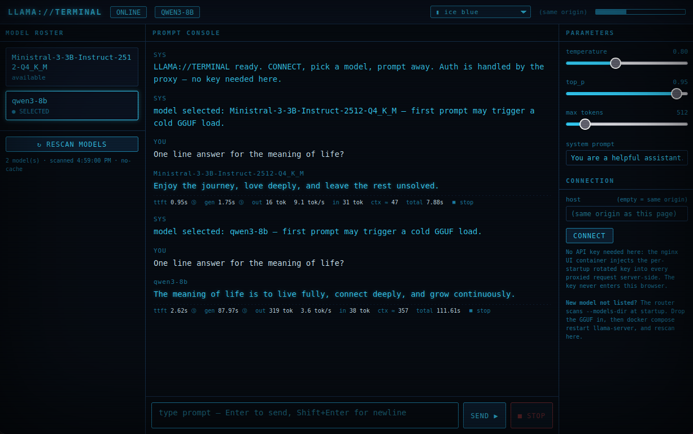

# llama_terminal

A hardened, self-hosted llama.cpp deployment: digest-pinned, SHA-verified build, router mode for multi-model switching, a neon-terminal web UI, and a per-startup rotating API key — all bound to localhost, all running as unprivileged users.



## Implementation

```
llama_terminal/
├── Dockerfile                  # llama-server image (SHA-verified build)
├── compose.yaml                # keygen + llama-server + llama-ui services
├── keygen.sh                   # per-startup key rotation script
├── nginx-default.conf          # UI proxy site config (auth injection)
├── terminal.html               # the dashboard (single file, no deps)
├── ask.sh                      # CLI client
├── README.md                   # this file
├── .env                        # your local config — NOT committed
├── .gitignore                  # ignores .env, models/
└── models/                     # *.gguf files — NOT committed
```

## Components

| File | Purpose |
|---|---|
| `Dockerfile` | Reproducible CPU-only `llama-server` build. Digest-pinned `ubuntu:24.04` (`BASE_IMAGE` ARG), source fetched by ref and verified against an expected commit SHA (`LLAMA_COMMIT_SHA`), no cURL in the build (the server cannot download models), only the `llama-server` binary ships to the runtime stage. |
| `compose.yaml` | Three services: `keygen` (one-shot key rotation), `llama-server` (router mode, no public port), `llama-ui` (nginx static page + auth-injecting API proxy). |
| `keygen.sh` | Runs once per `docker compose up` inside the keygen container. Generates a 32-byte random key and writes `api_key` (consumed by llama-server) and `auth.conf` (an nginx `proxy_set_header` snippet consumed by the UI). |
| `nginx-default.conf` | Site config for the UI container: serves the dashboard, proxies the API same-origin with SSE-safe settings (no buffering, 1h read timeout), a minimal endpoint whitelist (`/v1/*`, `/models`, `/health` only), per-IP rate limiting (10 r/s, burst 20). Includes the generated `auth.conf`. Deliberately NO CORS headers. |
| `terminal.html` | Single-page dashboard: model roster, streaming prompt console with STOP, sampling parameters, per-response telemetry footer, five color themes. All dynamic content rendered via textContent (XSS-hardened). |
| `ask.sh` | CLI client: streams answers to the terminal, auto-selects the first advertised model, reads the rotated key from `KEYS_DIR/api_key` (env fallbacks supported). |

## Setup

### 1. Build the llama-server image

Resolve the tag you want to a commit SHA, then build with both pinned:

```bash
git ls-remote https://github.com/ggml-org/llama.cpp.git v1.0.0   # take the full SHA
docker build \
  --build-arg LLAMA_VERSION=v1.0.0 \
  --build-arg LLAMA_COMMIT_SHA=YOUR_COMMIT_SHA \
  -t llama-server:v1.0.0 .
```

If `LLAMA_COMMIT_SHA` is empty the resolved SHA is recorded (`/source-ref`, `/image-revision`, image labels) but not enforced. A mismatch hard-fails the build — this is what guarantees a moved or re-cut tag cannot silently change what ships.

### 2. Create necessary folders

```bash
mkdir -p models
```

### 3. Create the `.env` file from this sample

```ini
# ---------- image ----------
IMAGE=llama-server:v1.0.0
CONTAINER_NAME=llama-server

MODEL_DIR=./models

# ---------- server tuning ----------
CONTEXT=8192             # KV cache budget lives here; keep modest on CPU
THREADS=8                # ~ physical cores minus 2
PARALLEL=1               # concurrent requests; 1 keeps memory predictable

# ---------- resources ----------
CPU_LIMIT=6
MEM_LIMIT=12g

# ---------- ui ----------
UI_CONTAINER_NAME=llama-ui
UI_PORT=8081                      # anything free on 127.0.0.1
UI_HTML_FILE=./terminal.html
UI_NGINX_CONF=./nginx-default.conf

# ---------- auth ----------
KEYS_DIR=/run/llama-keys
KEYGEN_CONTAINER_NAME=llama-keygen
KEYGEN_SCRIPT=./keygen.sh        # path to the script
```

### 4. Enable execution for the scripts

```bash
chmod +x ask.sh keygen.sh
```

### 5. Verify base image digests

The `BASE_IMAGE` ARG in the Dockerfile and the two compose images are digest-pinned. The values below are examples only — always read real digests from your own `docker images --digests` output and pin those:

```bash
docker pull ubuntu:24.04       && docker images --digests ubuntu
docker pull nginx:1.27-alpine  && docker images --digests nginx
docker pull alpine:3.20        && docker images --digests alpine
```

Then set them:

- Dockerfile: `ARG BASE_IMAGE=ubuntu:24.04@sha256:<digest>`
- compose.yaml: `image: nginx:1.27-alpine@sha256:<digest>`, `image: alpine:3.20@sha256:<digest>`

A digest is only meaningful as "exactly what I verified today" — never copy one from a tutorial or blog post.

### 6. Transfer model GGUF files into `models/`

Keep the directory flat (subdirectories confuse the `--models-dir` scanner), and if you add new files after startup, restart the server so it re-scans:

```bash
docker compose restart llama-server
```

Note: plain `restart` does not re-run keygen — fine while the tmpfs survives. After a **host reboot** the tmpfs is empty, so use `docker compose up -d` (which re-runs keygen) instead of `restart`, or llama-server will start against the empty placeholder key files.

### 7. Mount the keys tmpfs

Run after each host restart (or make permanent via the fstab line below):

```bash
sudo mkdir -p /run/llama-keys
sudo mount -t tmpfs -o size=1m,mode=750,uid=1000,gid=1000 tmpfs /run/llama-keys
touch /run/llama-keys/api_key /run/llama-keys/auth.conf   # placeholders for first boot
```

The two `touch` files matter: compose bind-mounts these single files into llama-server and llama-ui at container creation, so they must exist before the containers are created. keygen then `printf`s fresh content over them on every startup — a missed `touch` after a reboot shows up as "no such file or directory" at container creation.

Permanent mount — add to `/etc/fstab` (placeholders still need re-creating after reboot, e.g. in a small boot script or by hand before `up`):

```
tmpfs /run/llama-keys tmpfs size=1m,mode=750,uid=1000,gid=1000 0 0
```

Keys therefore live only in RAM: they survive `docker compose down`, vanish on host reboot, and are regenerated fresh at the next `up` — by design.

### 8. Start the application

```bash
docker compose up -d
docker compose ps        # keygen exits 0, llama-server + llama-ui healthy
```

### 9. Open the dashboard

```
http://127.0.0.1:8081
```

(or whatever `UI_PORT` you set in `.env`). No login, no API key — the proxy authenticates for you.

CLI:

```bash
./ask.sh "explain ephemeral ports"           # auto-selects first model
./ask.sh qwen3-8b "explain ephemeral ports"  # pin a specific model
cat notes.md | ./ask.sh
```

## UI elements

### Header (top bar)

- Left badge: connection status — `ONLINE` / `CONNECTING…` / `OFFLINE`
- Second badge: currently selected model
- Right dropdown: color theme
- Thin bar: context usage estimate (~tokens in current conversation)

### Model Roster (left panel)

- Lists all models the server advertises; click one to select it
- `⚡ resident` = already loaded in memory; `available` = will load on first use (may take a while)
- `↻ RESCAN MODELS` — refresh the list after adding models to `models/` and restarting the server

### Prompt Console (center)

- Type your prompt, press **Enter** to send (Shift+Enter = new line)
- Answers stream in live; `■ STOP` aborts generation
- Small line under each answer: response stats — time to first token (`ttft`), generation time, tokens in/out, speed (tok/s), how the answer ended
- Hover that line for the exact settings used (model, temperature, etc.)

### Parameters (right panel)

- **temperature** — 0–0.3: precise and deterministic; 0.7–1.0: balanced chat; higher: creative/varied
- **top_p** — leave at 0.95 unless deliberately experimenting
- **max tokens** — maximum length of one answer; raise if responses get cut off
- **system prompt** — standing instruction prepended to every request

### Connection (right panel, bottom)

- **host** — leave empty (uses this page's own address); set only for a different server
- **CONNECT** — re-scan models / re-establish link (also fixes a `401` after server restart)

Typical flow: CONNECT → pick a model → type prompt → Enter. Adjust temperature only when you want a different "flavor" of answer.

## Sampling parameters (per-request, set in the UI)

### Temperature (0–2)

Controls randomness in token selection. At each step the model computes a probability distribution over its vocabulary; temperature reshapes it. Low values (0.1–0.3) make the model pick near-deterministic high-probability tokens — precise, repetitive, good for code, math, factual recall. High values (0.8–1.2) flatten the distribution, letting lower-probability tokens win more often — more creative, varied, "inspired", but also more prone to rambling and mistakes. Around 0.7–0.8 is the conventional chat sweet spot. Note temperature 0 is *near*-deterministic, not fully — ties in probability can still break differently.

### Top_p (0–1, nucleus sampling)

Is a complement to temperature: instead of reshaping probabilities, it discards them. Keep only the smallest set of tokens whose cumulative probability exceeds top_p (0.95 = "the smallest set making up 95% of the probability mass") and sample within it. This adapts to confidence: when the model is certain, the nucleus is tiny (decisive); when it's uncertain, the nucleus is wide (exploratory). Practical advice: adjust one, leave the other at a sensible default (temp 0.8 + top_p 0.95, or temp 1.0 + top_p 0.9).

### Max tokens (16–4096)

Is just the output budget: the response stops after this many tokens regardless of whether it's "finished" (you'll see the yellow `length` marker in the response footer). 512 fits most explanations; longer for code or essays. Too-small values produce truncated answers that can confuse you into blaming the model.

## Server flags (fixed at container start, in compose)

`-c ${CONTEXT}` is the KV-cache context size — the sliding window of conversation the model can attend to, measured in tokens (prompt + response + system prompt). 8192 is roomy for chat; too small and long conversations silently degrade (early turns fall out of the window — watch the header's context meter). Cost warning: memory scales roughly linearly with context, so 32k quadruples cache RAM versus 8k on the same model — this competes with your `MEM_LIMIT`.

`-t ${THREADS}` is CPU threads for compute. Rough rule: match physical cores (the Dockerfile's build uses `nproc --ignore=2` as its parallelism hint). Oversubscribing — more threads than physical cores — causes contention that *slows* generation; it doesn't speed it up. Undersubscribing leaves performance on the table. Try small adjustments and watch tok/s in the response footers.

`--parallel ${PARALLEL}` runs N generation slots against shared context — allows concurrent requests (each gets `-c/N` usable context). Worth knowing: with `--parallel 4` and `-c 8192`, each request effectively has ~2048 tokens, not 8192. For a single-user dashboard, 1 is the honest setting.

### How they interact

Sampling params shape *what* the model says; server flags shape *how fast, how much memory, and how much it remembers*. Nothing about `-t` or `-c` changes the model's "personality"; nothing about temperature makes it faster or slower in any noticeable way. Practical tuning order: fix `THREADS` once via tok/s measurements, size `CONTEXT` to your real conversation lengths (check the ctx footer over a week of use), then treat temperature/top_p as per-task dials — low for technical work, higher for brainstorming.

## Security model

- **Network**: every published port binds `127.0.0.1` only. llama-server has no public port at all — the API is reachable exclusively through the nginx proxy.
- **Auth**: a fresh random key is generated on every `docker compose up`. The browser never sees it (nginx injects it server-side); `ask.sh` reads the key file from `KEYS_DIR`. Keys live on tmpfs (RAM-only).
- **Proxy controls**: minimal endpoint whitelist; `limit_req` (10 r/s per source, burst 20, 429 beyond); no CORS headers anywhere — do not add them. Because auth is injected server-side, CORS `Allow-Origin` headers would let any website you visit call the API.
- **Containers**: `read_only` rootfs, `cap_drop: [ALL]`, `no-new-privileges`, non-root uids (1000 for llama-server/keygen, 101 for nginx), tmpfs scratch, `pids_limit`, CPU/memory ceilings, log rotation, `init`.
- **Supply chain**: all images digest-pinned; llama.cpp source SHA-verified with hard-fail on mismatch.

Trust boundary note: because nginx injects auth for *anyone* who can reach the port, the effective gate is localhost access. Treat anything that can execute as your user as inside the boundary. If you ever expose `UI_PORT` beyond 127.0.0.1, add TLS termination or SSH tunneling first — the proxy speaks cleartext HTTP.

## Operating notes

**Model lifecycle (router mode)** — every `*.gguf` in `MODEL_DIR` is selectable per request via the `model` field. First use triggers a full cold load from disk (minutes on CPU; shows up as inflated ttft). LRU eviction applies past `--models-max` (default 4).

**Rotation vs. persistence** — models resident in RAM count against `MEM_LIMIT`. Unload idle ones (`POST /models/unload`) or lower the preset `stop-timeout` to reclaim memory.

**Known rabbit holes, documented so you skip them:**

- *Duplicate model IDs*: the router names entries from GGUF **metadata** (`general.name`), not the filename — two quants of the same model collide into one ID. Fix with a preset ini (`--models-preset`) that assigns explicit IDs.
- *Subdirectories*: the `--models-dir` scanner treats every subdir as a potential model folder; keep `models/` flat.
- *Non-root nginx*: needs tmpfs mounts with `uid=101,gid=101` (cache/pid dirs) — already in the compose file.
- *Keygen permission denied*: `KEYS_DIR` must be writable by uid 1000 (bind-mount semantics). The tmpfs mount sets `uid=1000,gid=1000` explicitly; for a disk-backed dir, `sudo chown -R 1000:1000` it.
- *First-boot key race*: single-file bind mounts need their source files to exist at container creation — that's what the `touch` placeholders in step 7 are for.

**Verification quickies**

```bash
docker compose logs llama-server | grep load_models   # what the router discovered
docker exec llama-server cat /source-ref              # what source this binary came from
docker exec llama-server cat /image-revision          # ...and its exact commit
# rate limiter live? (burst of 50 requests -> mix of 200s and 429s)
for i in $(seq 1 50); do curl -s -o /dev/null -w "%{http_code}\n" http://127.0.0.1:8081/health; done
```

## Updating

1. Pick the new upstream ref, resolve its SHA, rebuild with both `LLAMA_VERSION` + `LLAMA_COMMIT_SHA`, note both in your changelog.
2. Re-pin digests: `ubuntu:24.04` (Dockerfile `BASE_IMAGE`), `nginx:1.27-alpine` and `alpine:3.20` (compose.yaml).
3. `docker compose up -d` — keygen rotates the API key; browser clients just reconnect, `ask.sh` picks up the new key file automatically.
